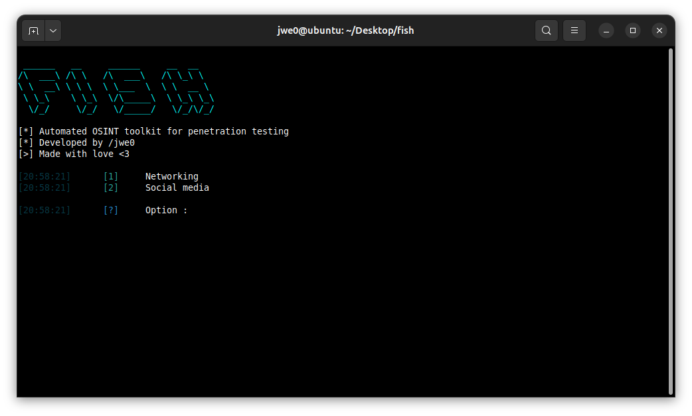
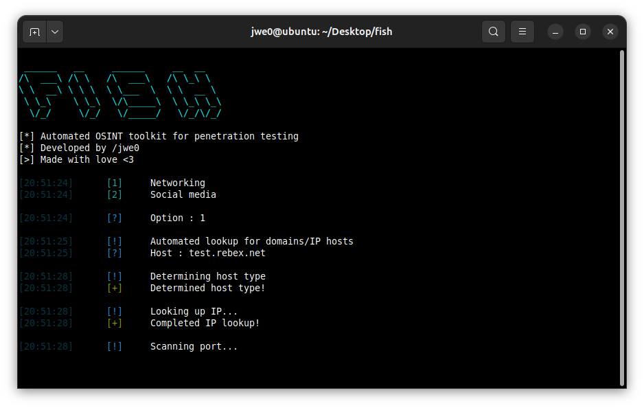
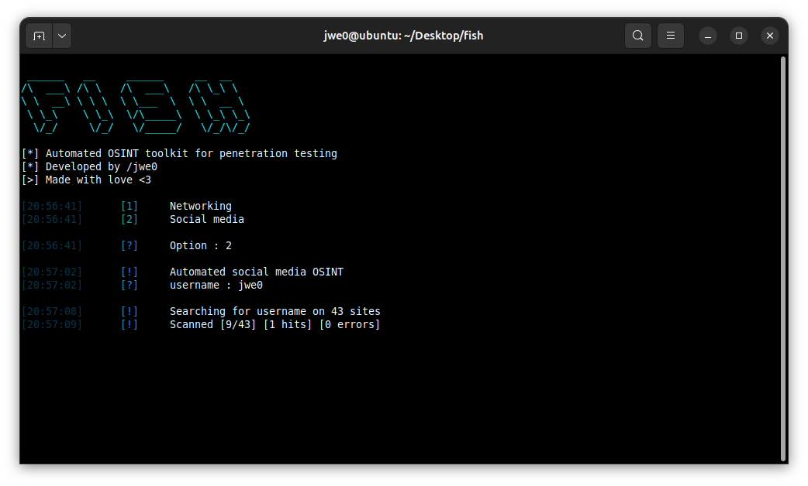
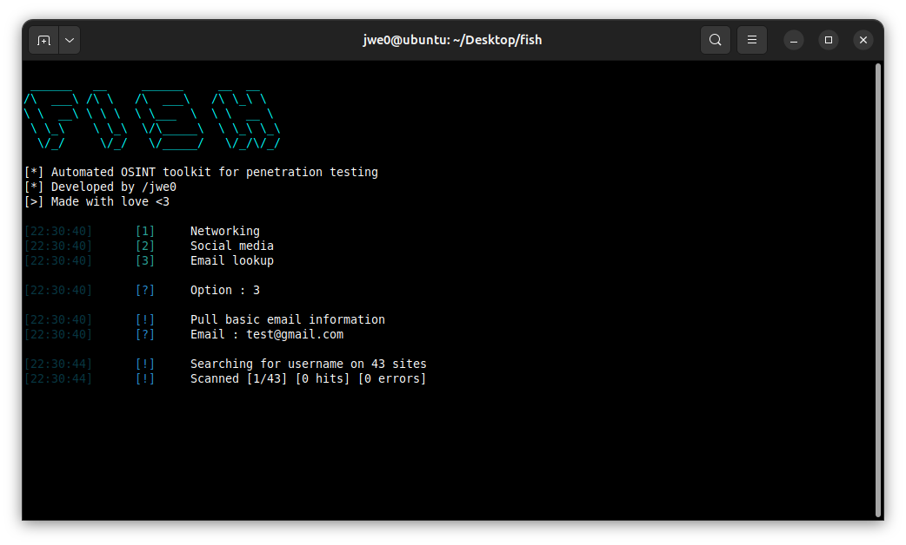
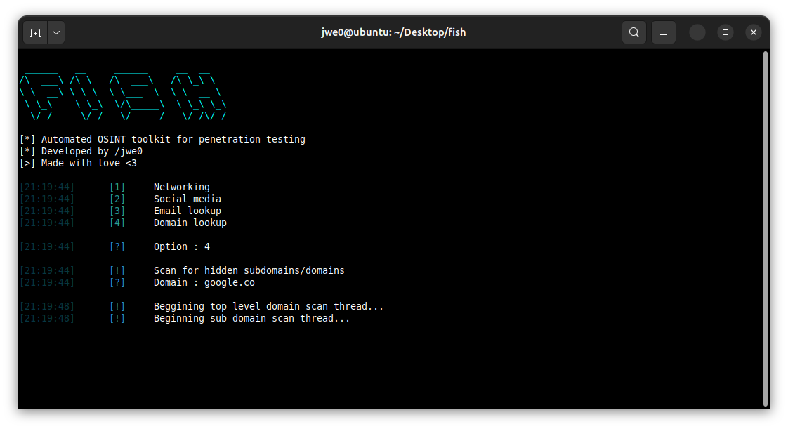
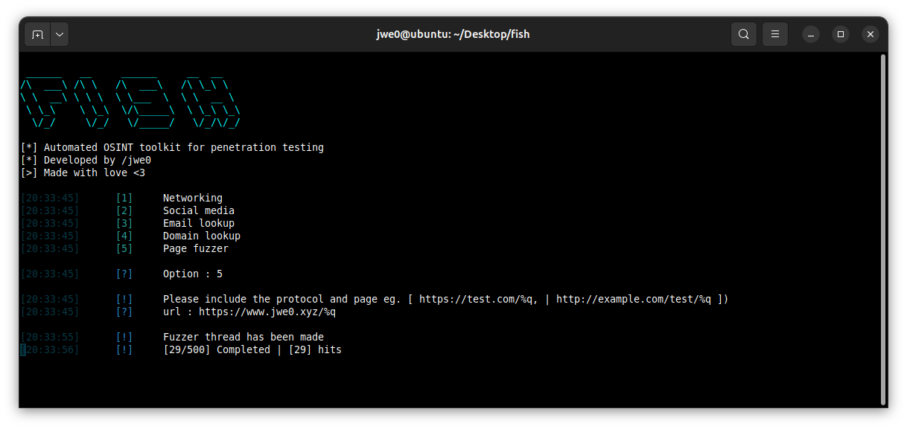

# Fish
> Easy recon toolset

   

## Features
### Host/Domain lookup
   
- Convert IP addreses to domains and domains to IPs
- Scan common expolited ports
- Extract banner info from hosts
- Whois lookup

### Username lookup
  
- Search for usernames on over 20 popular sites
- Extract extra information from certain sites
### Email lookup

- Search the username in the email
- Grab the domain info
- Whois domain
### Domain lookup

- Scan for top level domains
- Scan for subdomains
- Pull aliases and associated addresess
### Directory fuzzer

- Threaded lookups for optimized results
- Pull the status code of the response (only blocks 404 by default)
- Grab the page title

### Extra features
#### Social media
- Basic github information
- Fullname
- Username
- Location
- Local time
- URLs
- Socials
#### Whois
- Registar
- Creation, Expiration, Updated dates
- Name servers
- Org
- Email
- Country
- State
- City
## Instillation guides
1. Ensure you have the latest version of python
2. Install dependencies with `pip install -r requirements`
3. After instillation of requirements execute `python3 main.py`
4. Select your mode and let it do its magic!

## Basic troubleshooting
### My distro wont allow me to install dependencies?
- You may need a virtual environemt on certain distros, below is a basic guide
1. Ensure you have python3 venv installed with `sudo apt install python3-venv` for debian systems
2. Run `python3 -m venv env` to install a virtual environment to your project directory
3. Run `source env/bin/activate` to enter the virtual environment
4. Install your dependencies as listed before